# Worm Wars: a Worms 2 tribute for the browser

Made with **Grok Bot**.

Worm Wars is a turn-based artillery game in the style of Worms 2. It runs in the browser and is rendered with [Three.js](https://threejs.org/). It's a static site with no build step and no CDN, and Three.js is included in the repo.

**Play it here:** https://nishimura-katsuo.github.io/grokbot-worms-clone/

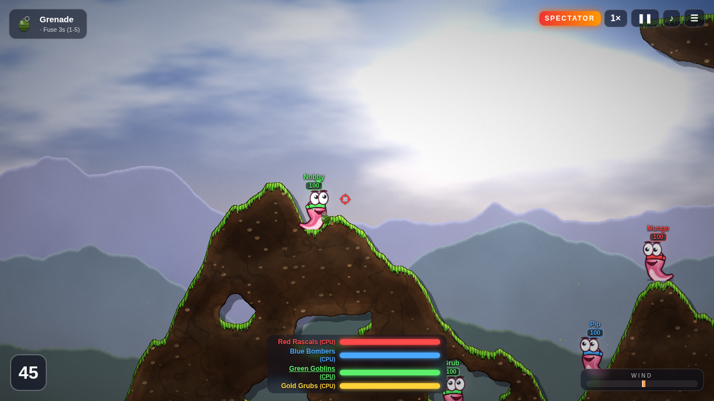

## Features
- **Destructible terrain.** Each map is generated procedurally with caves and floating islands. Explosions carve real craters with scorched edges. The terrain shader adds grass and snow caps, rim lighting, pebbles, strata and edge outlines, and explosions light it up as they go off.
- **Four landscapes:** Meadow, Desert, Winter and Alien. Each has its own sky, volumetric-looking clouds, three parallax mountain layers, ambient particles that drift with the wind, and animated layered water with foam, caustics and glints.
- **Effects:** bloom, fireballs, shockwaves, sparks, flying dirt, smoke trails, screen shake and a camera that follows projectiles.
- **Teams:** 2 to 4 teams with 2 to 5 worms each. Every worm has a name and a health bar. There's a turn timer, a retreat timer, fall damage, drowning, wind, and an optional sudden death mode where the water rises.
- **Weapons:** Bazooka (affected by wind), Homing Missile, Grenade (1 to 5 second fuse, bounces), Cluster Bomb, Banana Bomb, Shotgun (two shots), Dynamite, Air Strike, Jet Pack, Teleport, Girder and Skip Go. Limited weapons have ammo counts.
- **CPU opponents:** Easy, Normal and Hard. The AI simulates hundreds or thousands of trajectories per turn, taking wind, bounces and fuses into account. It picks targets and weapons (including shotgun line of sight, air strikes and homing missiles), avoids hitting its own team, moves when it has no good shot, and runs away from its own blasts. Lower difficulties have aiming errors added.
- **Spectator mode.** Set every team to CPU, or click **WATCH CPU BATTLE**, to watch a fully AI-driven match. The camera follows the shooter, the target, projectiles and explosions. You can change the speed (1×, 2×, 4× or 8×) and pause, and the match plays through to the victory screen.
- **Music and sound.** All audio is synthesized live with the Web Audio API, with no audio files. The music is original and procedurally composed: a menu theme, four battle tracks and a victory fanfare. Sound effects include explosions, shots, jumps, splashes and worm voice chirps. There's a mute toggle.

## The worms
The worms are drawn in the Worms 2 style as smooth vector art. Each body is drawn at 4× resolution with canvas curves, then used as a sprite.
- **Body:** an upright S-curve, fat at the round head and tapering to a small tail curled on the ground. It has a thick dark outline, gradient shading, a rim highlight, a lighter belly with subtle creases and a soft ground shadow. There are no segment rings.
- **Eyes:** big white oval eyes, close together on top of the head. They have black pupils that track the aim (or incoming shots) and eyelids that blink.
- **Face:** eyebrows, a large mouth and cheeks. The expressions are happy, grin, worried (with a sweat drop), shocked and determined.
- **Bandana:** in the team colour, wrapped across the forehead under the eyes, with a knot and fluttering tails.
- **Animation:** idle wiggle and breathing, a crawl cycle when walking, and squash and stretch on jumps and landings. The worm holds its weapon at the aim angle.
- **Death and victory:** a worm wobbles in shock before its death blast, then a gravestone drops in its place. The winners do a hopping victory dance.


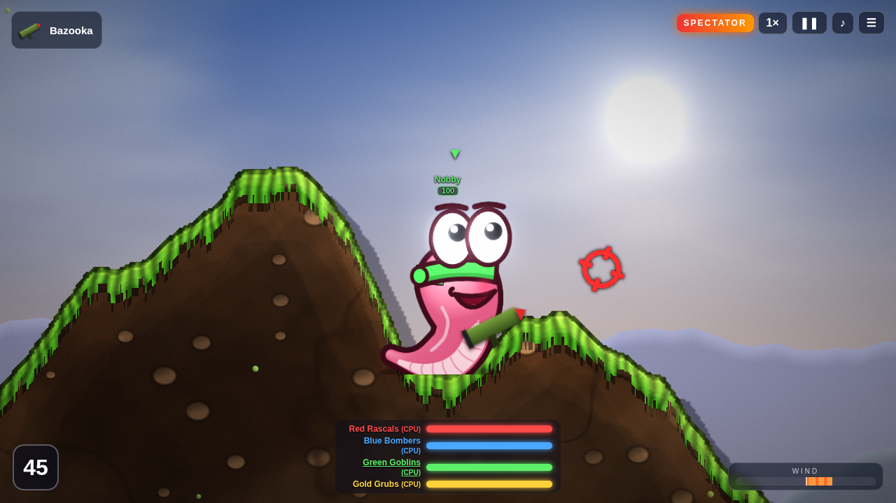

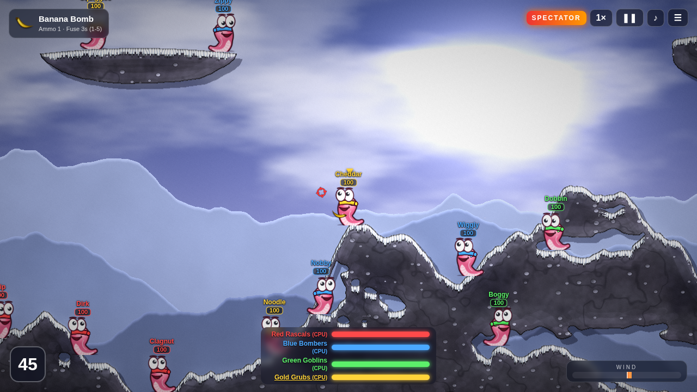

## Running locally
ES modules need an HTTP server, so double-clicking `index.html` won't work. From the repo folder, run:

```
python3 -m http.server 8000
```

Then open http://localhost:8000.

## Controls
| Key | Action |
|---|---|
| ← → | Walk |
| ↑ ↓ | Aim (tilts the girder too) |
| Enter | Jump forward |
| Backspace | Backflip |
| Space | Hold to charge, release to fire. Instant weapons fire on press. With the jet pack, press it to stop flying |
| Tab / right-click / ☰ | Weapon menu |
| 1 to 5 | Grenade, cluster and banana fuse time |
| Left-click | Pick a target (homing, air strike, teleport, girder), or drag to pan the camera |
| Mouse wheel | Zoom |
| P / Esc | Pause |
| M | Mute |
| 1 to 4 (spectator) or + | Game speed 1×, 2×, 4×, 8× |

Jet pack: ← → and ↑ to thrust.

## Screenshots
| | |
|---|---|
| 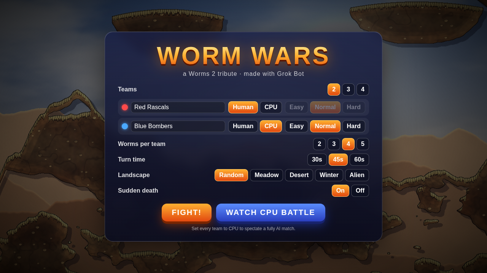 | 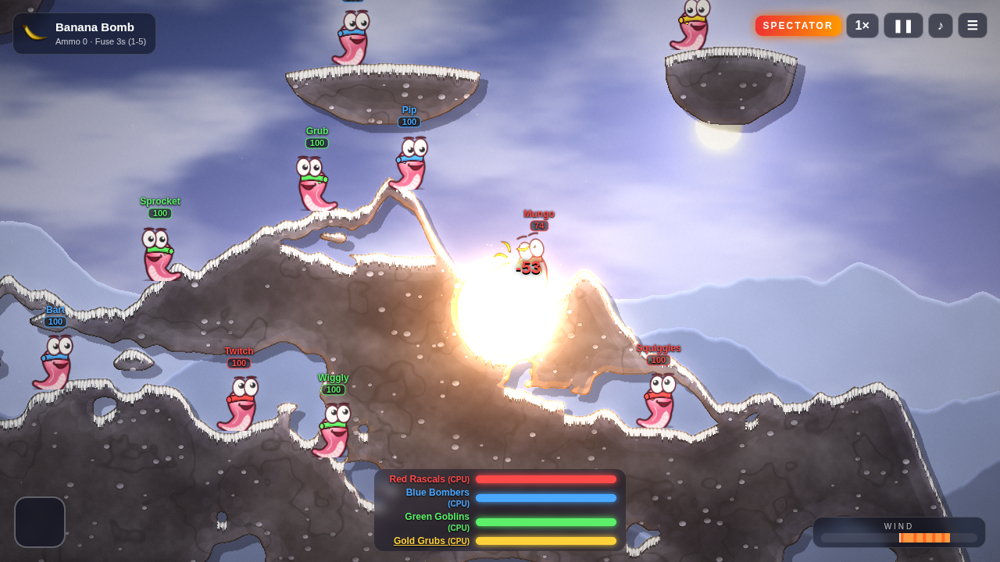 |
| 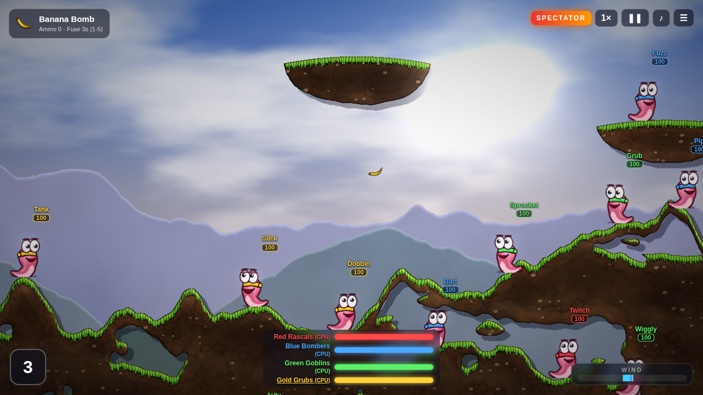 | 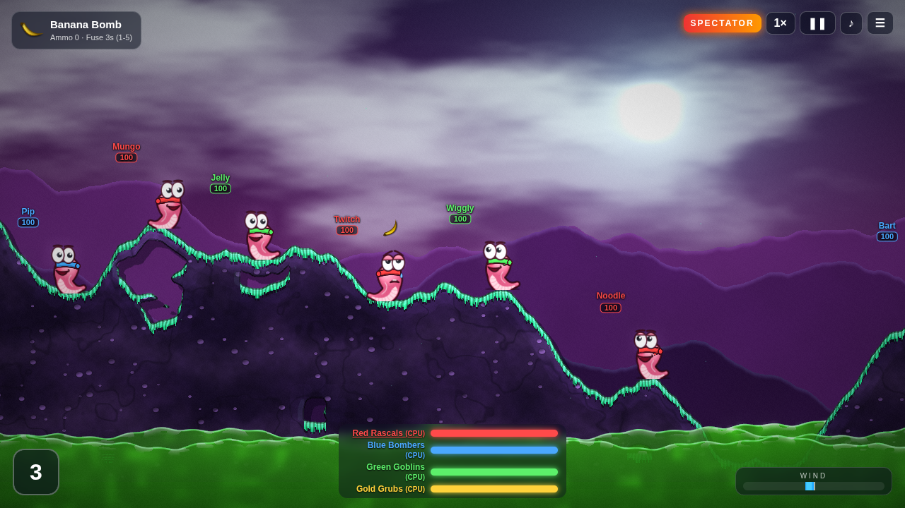 |
| 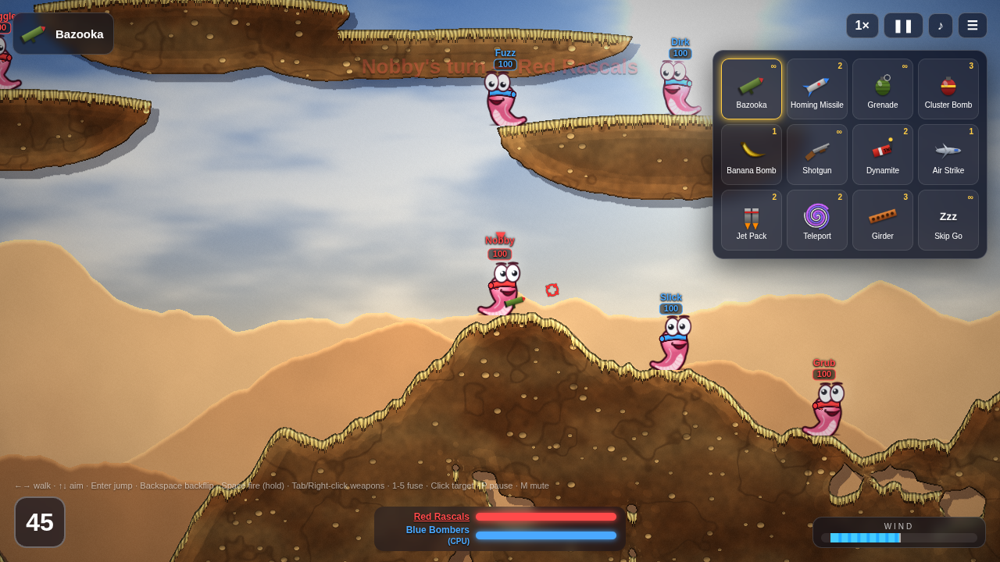 | 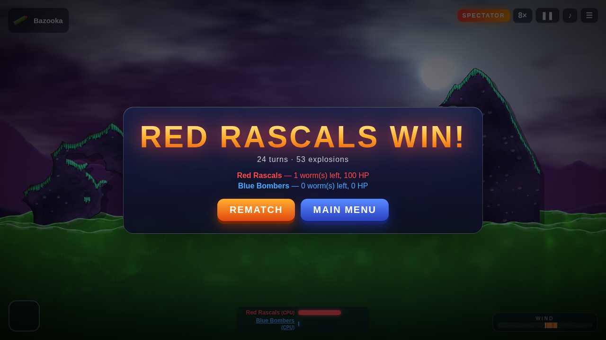 |
| 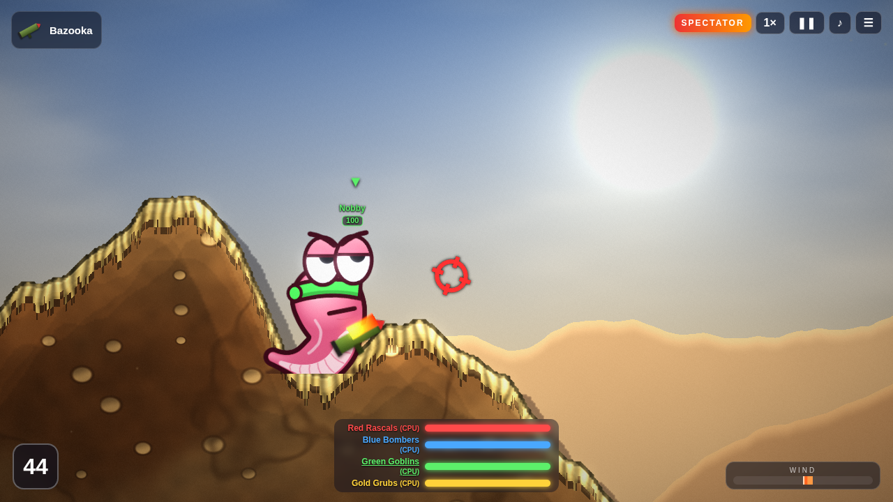 | 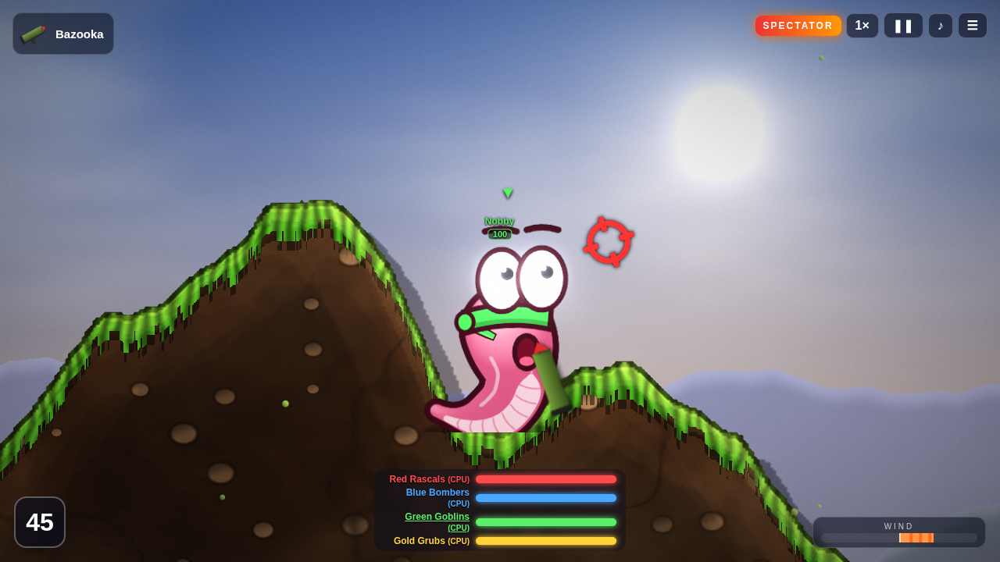 |
| 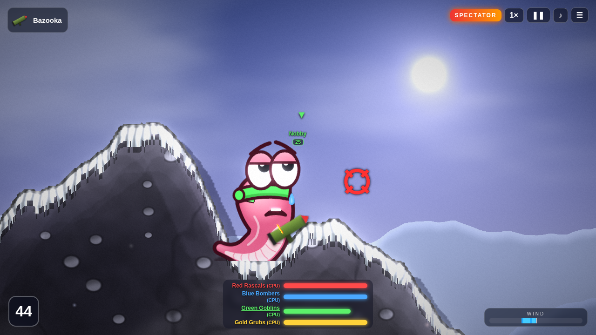 | 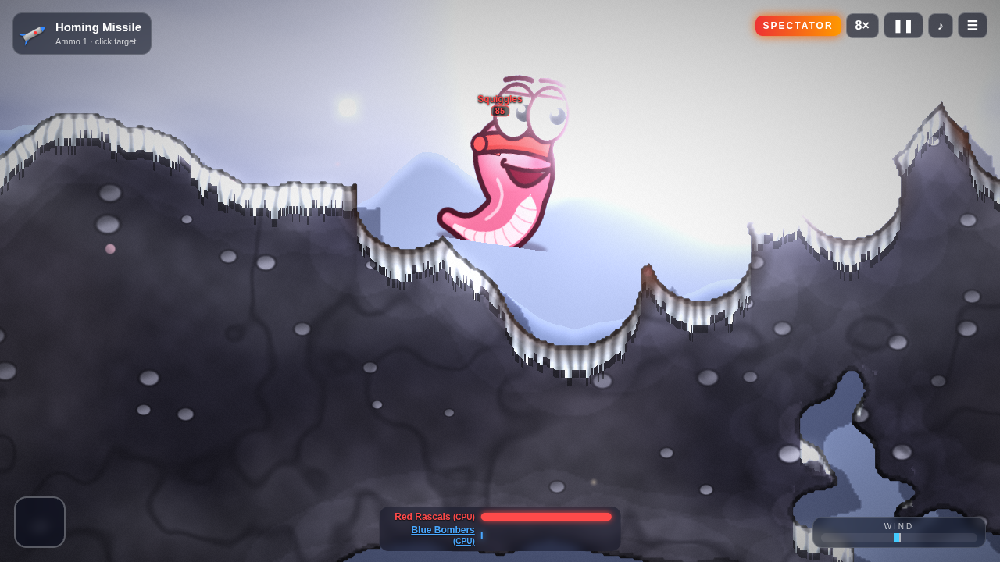 |

## Testing
See [REVIEW.md](REVIEW.md) for the QA report and the headless stress and fuzz test flags.

## Files
- `main.js`: rendering, terrain, physics, weapons, turn logic, AI and UI
- `audio.js`: procedural music sequencer and synthesized sound effects
- `three.module.js` and `addons/`: Three.js r160, included locally
